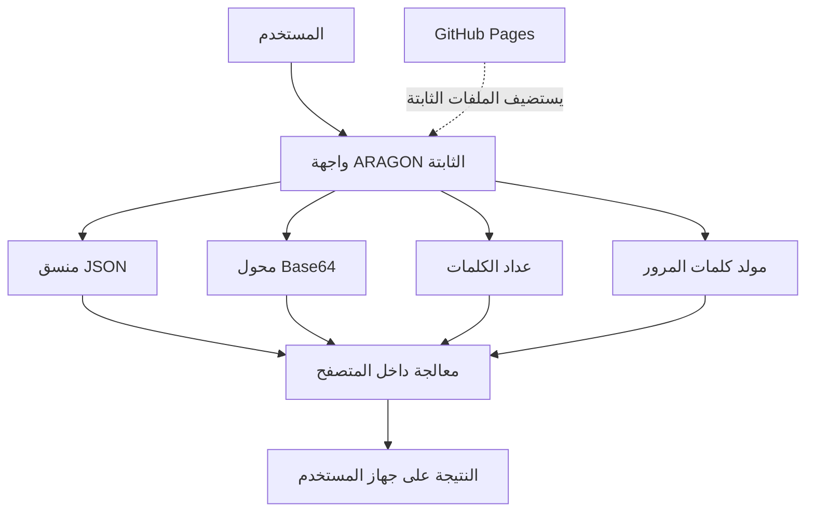

# ARAGON — أدوات ويب عربية مجانية

[](#حالة-المشروع-والجاهزية)
[](https://pages.github.com/)
[](#2-التقنيات-والإصدارات)
[](#3-المتطلبات-والاعتماديات)

**ARAGON مجموعة أدوات ويب مجانية باللغة العربية، تعمل بالكامل داخل المتصفح ويمكن نشرها كملفات ثابتة على GitHub Pages.** لا يوجد خادم أو قاعدة بيانات أو اعتماديات npm، ومدخلات المستخدم تُعالج محليًا في المتصفح ولا تُرسل إلى خدمة خارجية بواسطة الأدوات الحالية.

## 1. نظرة عامة على المشروع والمشكلة

تحتاج مهام يومية بسيطة مثل تنسيق JSON والتحويل بين Base64 وعدّ الكلمات وإنشاء كلمات المرور إلى أدوات سريعة دون رفع بيانات المستخدم إلى مواقع خارجية أو إنشاء حسابات.

يوفر ARAGON واجهة عربية متجاوبة لهذه المهام، مع دعم RTL ولوحة المفاتيح ووضع الألوان الداكن وفق إعداد النظام.

### الأدوات الحالية

- **منسّق JSON:** تنسيق والتحقق وتصغير JSON، مع حد إدخال مليون محرف.
- **محول Base64:** ترميز وفك ترميز UTF-8 بما في ذلك العربية. Base64 تمثيل للبيانات وليس تشفيرًا.
- **عداد الكلمات:** عد الكلمات والفقرات ومحارف Unicode مع تحديث فوري.
- **مولّد كلمات مرور:** يستخدم `crypto.getRandomValues` من المتصفح، مع خيارات للطول ومجموعات الحروف واستبعاد المحارف المتشابهة.

### البنية



لا يتضمن المسار الحالي خادم API أو قاعدة بيانات أو إرسالًا لمدخلات الأدوات إلى خدمة خارجية.

## 2. التقنيات والإصدارات

| الطبقة | التقنية |
|---|---|
| الواجهة | HTML5 |
| التنسيق | CSS3 |
| منطق الأدوات | JavaScript أصلي |
| التشفير العشوائي لكلمات المرور | Web Crypto API `crypto.getRandomValues` |
| النشر | GitHub Pages |
| التحقق | Node.js والوحدات المدمجة |
| الاعتماديات | لا توجد حزم npm أو مكتبات خارجية مطلوبة |

تُحمّل الواجهة ملفات CSS وJavaScript المحلية من المستودع. لا تعتمد على خطوط أو مكتبات أو صور من CDN خارجي.

## 3. المتطلبات والاعتماديات

- متصفح حديث يدعم JavaScript وWeb Crypto API.
- Git لتنزيل المستودع.
- Node.js لتشغيل فحوص التطوير والاختبارات.
- Python اختياري لتشغيل خادم ملفات محلي.

لا يحتاج تشغيل الأدوات إلى خادم خلفي أو قاعدة بيانات أو حساب API أو خدمة مدفوعة.

## 4. التثبيت والتشغيل محليًا

استنسخ المستودع:

```bash
git clone https://github.com/zopair/ARAGON-.git
cd ARAGON-
```

يمكن فتح `index.html` مباشرة في المتصفح، أو تشغيل خادم ملفات محلي:

```bash
python3 -m http.server 8000
```

ثم افتح:

`http://localhost:8000`

لفحص الروابط المحلية وسياسة CSP وصياغة JavaScript وتشغيل الاختبارات:

```bash
node scripts/check.mjs
node scripts/test.mjs
```

تستخدم الفحوص وحدات Node المدمجة ولا تحتاج إلى تثبيت حزم npm.

## 5. متغيرات البيئة والإعدادات

لا توجد متغيرات بيئة أو مفاتيح API مطلوبة لتشغيل الأدوات الحالية.

### سياسة الاتصالات والخصوصية

- تُعالج مدخلات الأدوات في المتصفح.
- لا تحتوي الواجهة على مفاتيح Binance Pay أو أسرار API.
- الاتصالات الخارجية مقيدة بسياسة CSP.
- لا يستخدم الموقع Binance Merchant API؛ توقيع الطلبات والتحقق الموثوق من الدفع يتطلبان خادمًا غير موجود في هذا المشروع.

قسم الدعم يعرض QR وروابط أو عناوين استقبال مباشرة قدمها مالك المشروع. يبدأ المتبرع التحويل ويؤكده داخل تطبيقه أو محفظته. الموقع لا يتصل بمحفظة، ولا يتحقق تلقائيًا من الاستلام، ولا يمنح مزايا مقابل الدفع. يجب على المستخدم مراجعة الشبكة والرمز والعنوان قبل تأكيد أي تحويل.

## 6. دليل الاستخدام والوظائف الأساسية

من الصفحة الرئيسية اختر الأداة المطلوبة:

1. **JSON:** الصق النص، ثم اختر التنسيق أو التحقق أو التصغير. حد الإدخال مليون محرف.
2. **Base64:** أدخل النص أو القيمة، ثم نفّذ الترميز أو فك الترميز. يدعم UTF-8 والعربية.
3. **عداد الكلمات:** الصق النص لعرض عدد الكلمات والفقرات ومحارف Unicode فورًا.
4. **كلمات المرور:** اختر الطول ومجموعات المحارف واستبعاد المتشابه، ثم أنشئ كلمة مرور باستخدام مولد العشوائية الآمن في المتصفح.

### حدود مهمة

- Base64 ليس تشفيرًا ولا يحمي البيانات بكلمة مرور.
- مولّد كلمات المرور يعتمد على دعم المتصفح لـWeb Crypto API؛ استخدم متصفحًا حديثًا وسياقًا آمنًا عند الحاجة.
- لا يضمن الموقع التحقق من تحويلات الدعم أو استلامها.
- لا تُعامل عناوين الدعم المباشر كتكامل دفع أو بوابة تجارة إلكترونية.

## 7. العرض المباشر ولقطات الشاشة

المشروع تطبيق ويب ثابت. ينشر سير العمل ملفات الموقع إلى GitHub Pages بعد اجتياز الفحوصات.

ملفات الواجهة الأساسية:
- `index.html` — الصفحة الرئيسية والتنقل.
- `tools/json/` — منسق JSON.
- `tools/base64/` — محول Base64.
- `tools/word-counter/` — عداد الكلمات.
- `tools/password/` — مولد كلمات المرور.
- `assets/css/site.css` و`assets/js/shared.js` — التنسيق والسلوك المشترك.

لا يعتمد هذا المستودع على خادم دائم. إذا لم يكن GitHub Pages مفعّلًا في إعدادات المستودع، اختر **Settings → Pages → Build and deployment → GitHub Actions** بعد رفع التغييرات.

## 8. الاختبارات والتحقق

شغّل الفحوص محليًا:

```bash
node scripts/check.mjs
node scripts/test.mjs
```

- `scripts/check.mjs` يفحص الروابط المحلية وسياسة CSP وصياغة JavaScript.
- `scripts/test.mjs` ينفذ الاختبارات الوظيفية للأدوات.
- `.github/workflows/pages.yml` يشغّل التحقق قبل نشر الملفات الثابتة إلى GitHub Pages.

إجراءات GitHub الخارجية مثبتة على إصدارات/معرّفات محددة، وتُراجع تفاصيلها في [SOURCES.md](SOURCES.md).

## حالة المشروع والجاهزية

**الحالة: نسخة تجريبية عاملة من أدوات ويب ثابتة.** الأدوات الأربع موجودة في الشفرة، وتعمل داخل المتصفح، مع فحوص محلية ونشر ثابت عبر GitHub Pages.

| المجال | الحالة الحالية |
|---|---|
| منسق JSON | منفذ؛ حد إدخال مليون محرف |
| محول Base64 | منفذ؛ UTF-8 والعربية |
| عداد الكلمات | منفذ؛ كلمات وفقرات ومحارف Unicode |
| مولد كلمات المرور | منفذ؛ Web Crypto API |
| معالجة البيانات | داخل المتصفح |
| خادم / قاعدة بيانات | غير موجود |
| تكامل دفع | غير موجود؛ روابط دعم مباشرة فقط |
| التحقق من استلام التبرع | غير موجود |
| اختبارات وفحوص | سكربتات Node مدمجة |
| النشر | GitHub Pages workflow |
| ترخيص المشروع | لا يوجد ملف LICENSE حاليًا |

### الجاهزية للتخصيص المؤسسي

يمكن إضافة أدوات متصفح مستقلة مع الحفاظ على عدم إرسال مدخلات المستخدم إلى خادم، وإضافة اختبارات CSP والروابط المحلية، ومراجعة كل أصل أو إجراء خارجي قبل اعتماده. لا ينبغي تقديم الموقع كمنصة دفع أو تطبيق خلفي ما لم تتم إضافة هذه المكونات واختبارها فعليًا.

### سجل التغييرات

- **2026-11-26:** إعادة تنظيم README في ثمانية أقسام تقنية، مع توضيح الأدوات الفعلية وحدود الخصوصية والدفع والنشر. لم يتغير كود التطبيق أو سير العمل.

## الملكية الفكرية ونسبة التأليف

تأليف المشروع ونسبته: **Aly Hussein Zopair (علي حسين زبير ALY HUSSEIN ZOPAIR)**.

هذا الإقرار لا يُعد ترخيصًا لإعادة الاستخدام. لا يوجد ملف LICENSE للمشروع حاليًا. إجراءات GitHub والأصول والخدمات الخارجية المشار إليها في [SOURCES.md](SOURCES.md) تحتفظ بتراخيصها وشروطها الأصلية.
